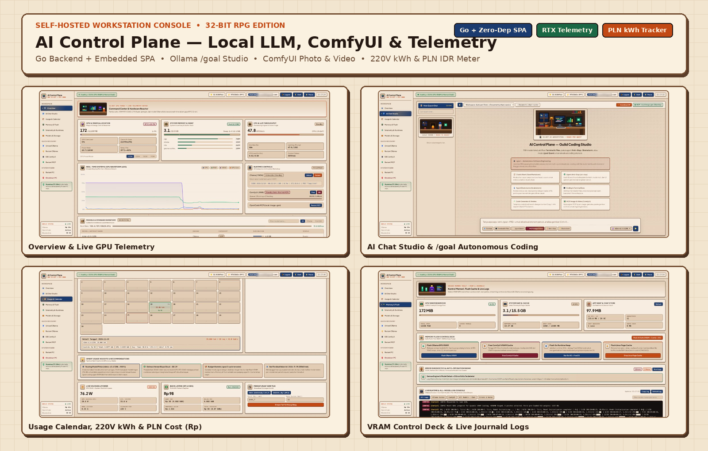
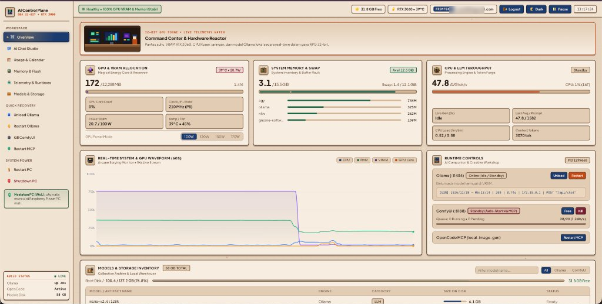
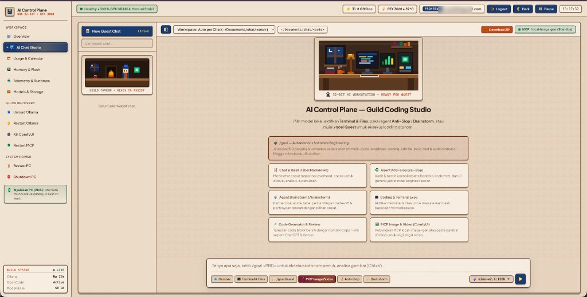
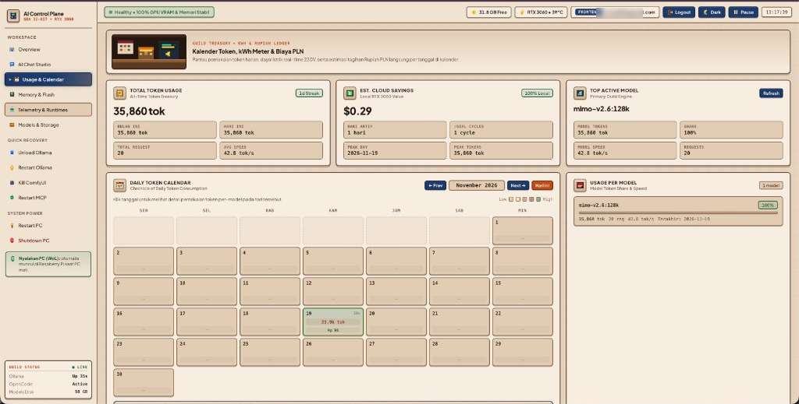
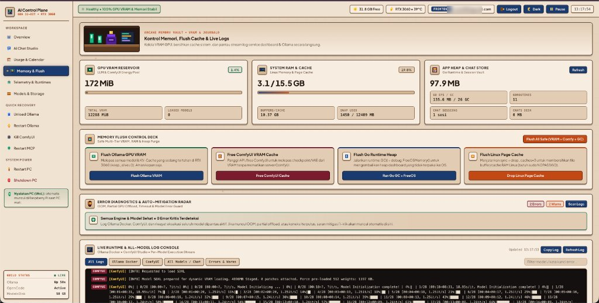
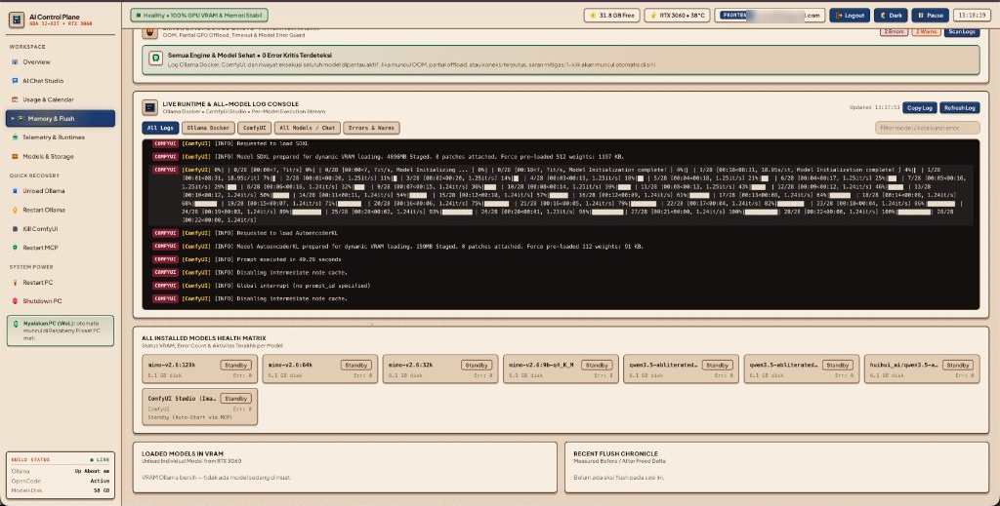

# AI Control Plane — 32-Bit RPG Edition

Self-hosted AI Workstation Console built with a modular **Go** backend and an embedded zero-dependency **32-bit RPG** web SPA. Designed for managing local **Ollama** LLMs, **ComfyUI** photo/video generation, real-time **NVIDIA GPU** telemetry, and **220V kWh / PLN Rupiah (IDR)** electricity cost tracking.



## Key Features

- **AI Chat Studio & `/goal` Autonomous Coding**
  - Streaming chat with local Ollama models, `/goal` multi-cycle autonomous coding loop, `/ai-slop` & `/brainstorm` agent modes, workspace file/terminal tools, and 1-click workspace + media ZIP export (`/api/chats/{id}/zip`).
  - Integrated **ComfyUI Studio** (`generate_image`, `generate_video`) with live progress tracking and `txt2img` / `img2img` support.
- **Live GPU & System Telemetry**
  - Real-time `nvidia-smi` GPU load, VRAM allocation, power draw, fan/temperature, CPU/RAM/swap metrics, top memory consumers, 60-second live waveform, and GPU power-limit controls (`100W`–`170W`).
- **Usage Calendar, kWh Meter & PLN Cost Tracker (IDR)**
  - Daily token consumption calendar with per-model breakdown, cloud savings estimate, and real-time **220V AC** wattage/ampere + daily/monthly **kWh & Rupiah (PLN)** cost tracking with configurable tariff presets.
- **Memory & Flush Control + Live Logs**
  - 1-click Ollama VRAM unload, ComfyUI cache free, Go runtime GC, Linux page-cache drop, error diagnostics radar, and live `journalctl` / ComfyUI log console.
- **Auth & Raspberry Pi Companion Support**
  - Development username/password login and optional Google OAuth Sign-In (`JWT HS256` + CSRF protection + email whitelist), plus cross-compiled `linux/arm64` binary support for Raspberry Pi Wake-on-LAN control.

## Project Structure

```text
ai-dashboard/
├── main.go                 # HTTP server startup, route wiring, graceful shutdown
├── internal/
│   ├── auth/               # Google OAuth, JWT HS256 sessions, whitelist middleware
│   ├── chat/               # Ollama streaming, /goal loop, MCP tools, usage & memory APIs
│   └── telemetry/          # GPU/CPU/RAM sampler, actions, 220V kWh & PLN IDR tracker
├── web/
│   ├── embed.go            # Embedded static assets
│   ├── index.html          # 32-bit RPG Control Plane SPA
│   └── login.html          # 32-bit RPG Guild Gatekeeper login page
└── docs/                   # Showcase banner & screenshots
```

## Quick Start

```bash
# Run tests
go test -race ./...

# Build binary
go build -o ai-dashboard .

# Run server (default :8095)
./ai-dashboard
```

### Configuration & flags

The application loads a project `.env` file at startup. Values already supplied by the shell, Docker, or systemd take precedence; when `.env` is absent, those external environment values are used as-is. Copy `.env.example` to `.env` to configure local development. `.env` is ignored by Git. The supported variables are `APP_ADDR`, `AUTH_MODE`, `DEV_AUTO_KILL_PORT`, `BACKEND_URL`, `GOOGLE_CLIENT_ID`, `ALLOWED_EMAILS`, `OLLAMA_URL`, and `COMFYUI_URL`. `APP_ADDR` defaults to `0.0.0.0:8095` (all network interfaces), while Ollama and ComfyUI URLs default to `http://127.0.0.1:11434` and `http://127.0.0.1:8188` respectively.

| Flag | Environment variable | Default | Description |
| --- | --- | --- | --- |
| `-addr` | `APP_ADDR` | `0.0.0.0:8095` | HTTP listen address. The default listens on all interfaces. |
| `-mode` | — | `hybrid` | Server mode: `hybrid`, `backend`, or `frontend`. |
| `-auth-mode` | `AUTH_MODE` | `development` | Authentication mode: `development` enables username/password; `google` requires Google Sign-In. |
| `-backend-url` | `BACKEND_URL` | — | Backend API URL when running in `frontend` mode. |
| `-cors-origins` | — | — | Comma-separated allowed CORS origins for backend mode. |
| `-google-client-id` | `GOOGLE_CLIENT_ID` | Built-in client ID | Google OAuth Client ID. |
| `-allowed-emails` | `ALLOWED_EMAILS` | Stored/default whitelist | Comma-separated email whitelist for Google login. |
| `-google-only` | — | `false` | Disable password login and allow Google login only. |
| `-set-user` | — | — | Create or update a local username at startup (use with `-set-pass`). |
| `-set-pass` | — | — | Password for `-set-user`. |
| `-del-user` | — | — | Delete a local username at startup. |
| `-set-only` | — | `false` | Apply user-management flags and exit without starting the server. |

In development mode, `DEV_AUTO_KILL_PORT=true` (default) releases TCP port `8095` before starting the server, so this works even when an older `go run main.go` instance is still running. It is never applied in `AUTH_MODE=google` mode. Set `DEV_AUTO_KILL_PORT=false` to disable this behavior.

Examples:

```bash
# Local development login (default)
go run . -addr 0.0.0.0:8095 -mode hybrid

# Require Google Sign-In
AUTH_MODE=google ./ai-dashboard

# Create/update a local account, then exit
./ai-dashboard -set-user rizal -set-pass 'change-this-password' -set-only

# Run the frontend proxy against a backend server
BACKEND_URL=http://192.168.1.10:8095 ./ai-dashboard -mode=frontend
```

With `APP_ADDR=0.0.0.0:8095`, open the app locally at `http://127.0.0.1:8095/` or through the machine's Tailscale IP at `http://100.74.64.82:8095/` (when connected to the same tailnet).

`go run` compiles the application when started (with Go's build cache), so it is convenient for development but may perform more disk I/O than starting an already-built binary. To avoid recompiling on every restart, build once with `go build -o ai-dashboard .`, then start `./ai-dashboard`; both commands load the same project `.env` file.

If no local account exists, the initial development account credentials are generated into `initial_credentials.txt`. Existing accounts in `auth_config.json` are preserved.

Cross-compile for Raspberry Pi (`arm64`):

```bash
GOOS=linux GOARCH=arm64 go build -o dist/ai-dashboard-rpi-arm64 .
```

## Gallery

| Overview & GPU Telemetry | AI Chat Studio |
| --- | --- |
|  |  |

| Usage & Token Calendar | Live Voltage, kWh & PLN Cost (IDR) |
| --- | --- |
|  |  |

| Memory & Flush Control Deck | Live Runtime & ComfyUI Logs |
| --- | --- |
|  |  |
