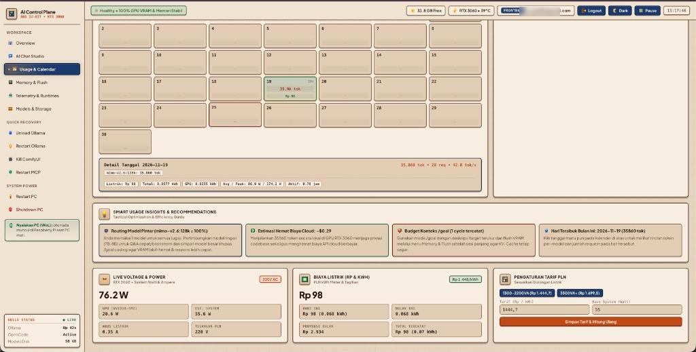

# AI Control Plane — 32-Bit RPG Edition

Self-hosted AI Workstation Console built with a modular **Go** backend and an embedded zero-dependency **32-bit RPG** web SPA. Designed for managing local **Ollama** LLMs, **ComfyUI** photo/video generation, real-time **NVIDIA GPU** telemetry, and **220V kWh / PLN Rupiah (IDR)** electricity cost tracking.


## Key Features

- **AI Chat Studio & `/goal` Autonomous Coding**
  - Streaming chat with local Ollama models, `/goal` multi-cycle autonomous coding loop, `/ai-slop` & `/brainstorm` agent modes, workspace file/terminal tools, and 1-click workspace + media ZIP export (`/api/chats/{id}/zip`).
  - Integrated **ComfyUI Studio** (`generate_image`, `generate_video`) with live progress tracking and `txt2img` / `img2img` support.
- **Live GPU & System Telemetry**
  - Real-time `nvidia-smi` GPU load, VRAM allocation, power draw, fan/temperature, CPU/RAM/swap metrics, top memory consumers, 60-second live waveform, and GPU power-limit controls (`100W`–`170W`).
- **Usage Calendar, kWh Meter & PLN Cost Tracker (IDR)**
  - Daily token consumption calendar with per-model breakdown, cloud savings estimate, and real-time **220V AC** wattage/ampere + daily/monthly **kWh & Rupiah (PLN)** cost tracking with configurable tariff presets.
- **Memory & Flush Control + Live Logs**
  - 1-click Ollama VRAM unload, ComfyUI cache free, Go runtime GC, Linux page-cache drop, error diagnostics radar, and live `journalctl` / ComfyUI log console.
- **Auth & Raspberry Pi Companion Support**
  - Google OAuth Sign-In (`JWT HS256` + CSRF protection + email whitelist) and cross-compiled `linux/arm64` binary support for Raspberry Pi Wake-on-LAN control.

## Project Structure

```text
ai-dashboard/
├── main.go                 # HTTP server startup, route wiring, graceful shutdown
├── internal/
│   ├── auth/               # Google OAuth, JWT HS256 sessions, whitelist middleware
│   ├── chat/               # Ollama streaming, /goal loop, MCP tools, usage & memory APIs
│   └── telemetry/          # GPU/CPU/RAM sampler, actions, 220V kWh & PLN IDR tracker
├── web/
│   ├── embed.go            # Embedded static assets
│   ├── index.html          # 32-bit RPG Control Plane SPA
│   └── login.html          # 32-bit RPG Guild Gatekeeper login page
└── docs/                   # Showcase banner & screenshots
```

## Quick Start

```bash
# Run tests
go test -race ./...

# Build binary
go build -o ai-dashboard .

# Run server (default :8095)
./ai-dashboard
```

Cross-compile for Raspberry Pi (`arm64`):

```bash
GOOS=linux GOARCH=arm64 go build -o dist/ai-dashboard-rpi-arm64 .
```

## Gallery

| Overview & GPU Telemetry | AI Chat Studio |
| --- | --- |
|  |  |

| Usage & Token Calendar | Live Voltage, kWh & PLN Cost (IDR) |
| --- | --- |
|  |  |

| Memory & Flush Control Deck | Live Runtime & ComfyUI Logs |
| --- | --- |
|  |  |
